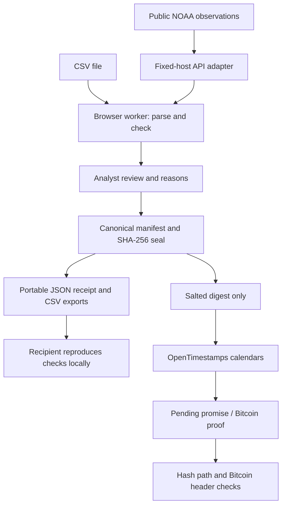
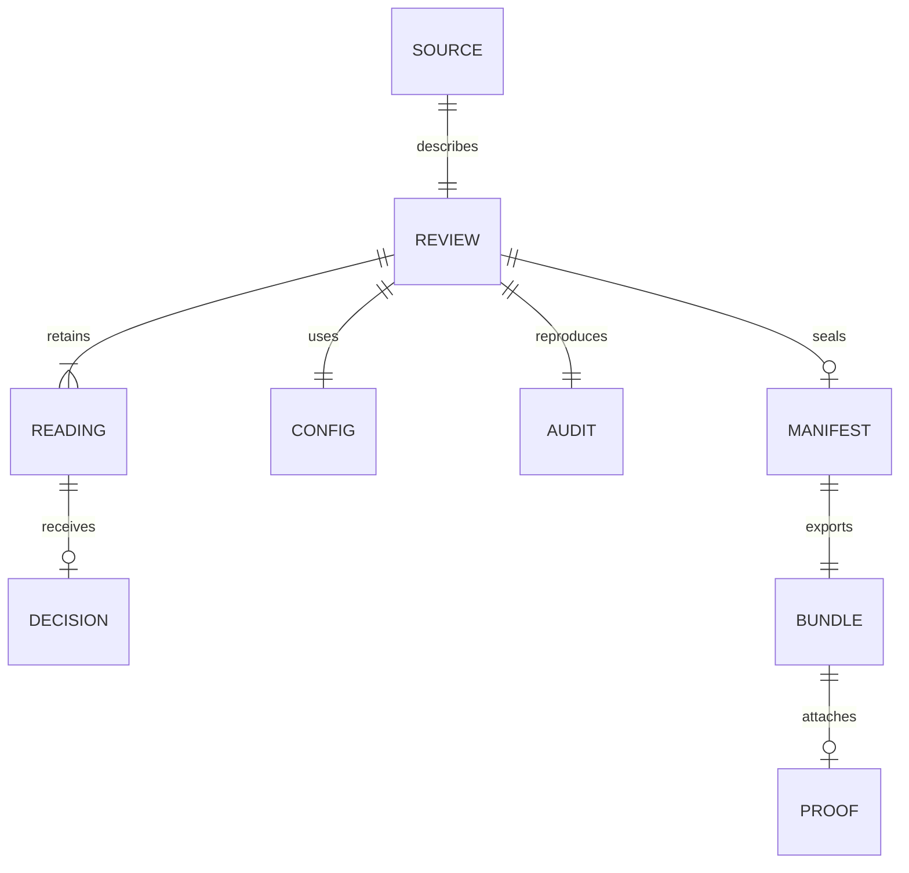

<div align="center">

<h1>Tideprint</h1>
<p><strong>Water data, with a clear record.</strong></p>
<p>Review unusual coastal readings. Keep the originals. Share reproducible evidence.</p>

[Open Tideprint](https://tideprint.vercel.app) · [Method & research](docs/RESEARCH.md) · [Security boundaries](SECURITY.md)


</div>

## The problem

A water-level spike can be a sensor fault—or the event a coastal analyst needs to understand. A cleaned spreadsheet often loses the original value, the check settings and the reason someone excluded a reading. A file hash alone cannot explain that review.

Tideprint keeps the observation and the decision together. It is a small, usable review workbench for a coastal-data analyst or community monitoring coordinator. It does not forecast floods or certify sensor accuracy.

## Use it

1. Open public NOAA observations or import a `timestamp,value` CSV in metres and UTC.
2. Inspect transparent rule flags and a real, deterministic Isolation Forest model fitted to that batch.
3. Keep or exclude flagged readings, with reasons. Originals are never removed. Bulk decisions name the selected rows and use an explicit reason.
4. Seal the original-byte hash, provenance, settings, reproduced results, reviewer label and decisions into a portable receipt.
5. Export the receipt, reviewed CSV or original CSV. Reopen a receipt and reproduce its checks. A changed value or note fails verification against the original digest.
6. Optionally timestamp a salted digest through public OpenTimestamps calendars. Keep the standard `.ots` proof; upgrade and check it later against a Bitcoin block header.

**No sign-in, wallet, fee, API key or central database.** Work stays in browser storage. The server handles public NOAA queries and digests/proofs, not private CSVs or review notes. Export important work before clearing site data.

The home page includes a real archived NOAA day and opens only original observations. A deliberately modified fixture remains in the test suite, with every edit documented; it is not offered as observed data in the main workflow.

## What makes it different

The focused contribution is the complete review-to-receipt workflow: deterministic machine-learning triage, human decisions, original-byte preservation, reproducible checks and a wallet-free Bitcoin proof. The algorithms and timestamp protocol are established work. Similar products exist; see the competitor review and five-idea comparison in [research](docs/RESEARCH.md). There is no claim of being the first or of validated detection accuracy.

## Architecture





This is a domain model, not a hosted database schema. A device-local workflow does not need Supabase, accounts or role management. The code keeps pure core logic separate from UI and bounded network adapters.

| Area | Implementation |
|---|---|
| Interface | React, TypeScript, Vite; self-hosted Instrument Sans; original wave mark |
| Checks | Missing/range/spike/rate/flat-line/time/gap rules; seeded Isolation Forest |
| Model | 64 trees, sample up to 128, seed 73129; 4 stated features; minimum 16 numeric rows |
| Seal | SHA-256 over a sorted-key canonical manifest, with original CSV-byte hash |
| Persistence | Versioned local storage; 30 saved items; validated workspace backup/restore; Web Locks and stale-tab protection |
| APIs | Node 24 Vercel functions; fixed hosts, bounded inputs/timeouts; NOAA CDN caching; deployed regional IP rate limit |
| Timestamp | Original bounded OTS v1 subset; SHA-256, append, prepend, reverse |
| Bitcoin | Blockstream header fetch; path/Merkle match, double-SHA-256 and PoW target check |
| Explanation | Interactive 54-part paper press, generated with the MIT Anatomy kit |

### Data flow and API contracts

- `GET /api/health` → function status and release identifier; no claim about upstream uptime.
- `GET /api/noaa?station=9414290&date=2024-10-01` → `{rawCSV, source}`. Three supported stations; one 24-hour window including its closing observation. Metres, UTC, MLLW. Source URL and retrieval time are retained.
- `POST /api/stamp` with JSON `{digest}` → `{proof, status:"pending", calendars, message}`. A random nonce salts the hash before calendar submission.
- `POST /api/proof` with `{digest, proof, upgrade:true}` → a standard proof plus `pending`, `unverified` or `confirmed` status. Bitcoin confirmation requires the path and header checks; failed explorer access never becomes success.

Errors use `{error}` and an appropriate HTTP status. Incoming CSV and receipt verification run locally. `source.kind`, original bytes, algorithm version and review reasons are part of the manifest; the optional proof is outside the seal so it can be upgraded without changing the reviewed record.

### Timestamp trust

A pending calendar promise is **not** a confirmed Bitcoin timestamp. Confirmation may take hours. A verified proof supports prior existence of committed bytes, not their accuracy or authorship. Blockstream supplies the chain view; Tideprint verifies the fetched header's hash, Merkle root and proof of work but does not run Bitcoin consensus or select a chain independently. Use a full-node OpenTimestamps verifier for stronger independence.

To verify externally, export the canonical **Manifest JSON** and its matching **.ots proof**. The OTS file timestamps that manifest, not the raw CSV by itself.

## Run locally

Use Node 24 and npm. No environment variables are needed; `.env.example` documents that choice.

```bash
npm ci --ignore-scripts
npm run dev
```

Vite serves the interface and local `/api` adapters. Open the URL printed by Vite. To check a production build:

```bash
npm test
npm run build
npm audit
npm run preview
```

`preview` serves the static build only; live API adapters require `npm run dev` or the Vercel deployment. Dependency lifecycle scripts are disabled in `.npmrc`. The committed lockfile pins versions.

## Deploy

Import this repository into Vercel with the Vite preset, Node 24, build command `npm run build`, install command `npm ci --ignore-scripts`, and output `dist`. `vercel.json` supplies functions and security headers. No secrets or paid features are required. Keep preview access controls and make the intended production URL publicly readable for judges.

The live production deployment is [tideprint.vercel.app](https://tideprint.vercel.app). Deployment evidence and tested limitations are recorded in [validation](docs/VALIDATION.md).

## Tests and limits

Run `npm test` for parsing, QA, model determinism, receipt tampering, CSV injection, request boundaries and OTS format tests. A new seal is not a signature: a malicious author can issue a different receipt. Always compare the digest with a trusted copy supplied independently.

- CSV: 1 MiB, 3,000 readings, exactly `timestamp,value`, explicit UTC, metres, declared vertical datum.
- Receipt: 5 MiB. OTS proof: 64 KiB, bounded nesting and operations. Unsupported attestations/operations fail closed.
- Six-minute review profile only. No unit/datum conversion or QARTOD certification.
- No shared cloud workspace, authenticated reviewer, cross-device sync or global API rate limiter.
- No field deployment, user study, detection benchmark, carbon impact measurement or flood prediction is claimed.

## Sources and licenses

NOAA observations are attributed with their exact request URL and retrieval metadata in `public/data/provenance.json`. The changed practice CSV lists every deliberate modification. QA is inspired by [IOOS QARTOD](https://cdn.ioos.noaa.gov/media/2021/04/QARTOD_WaterLevelManual_Update_V2.1_Final.pdf); the model follows [Isolation Forest (2008)](https://doi.org/10.1109/ICDM.2008.17). The OTS wire implementation is original code based on public protocol facts and cross-checked with the official Python implementation; reference source is not bundled.

Application code: [MIT](LICENSE). Anatomy kit: [MIT notice](vendor/anatomy/LICENSE). Instrument Sans: [SIL Open Font License](public/fonts/OFL.txt). No protected reference assets are copied.

Built for the **IEEE ClimateChain Global Hackathon**, Climate Data & Environmental Monitoring track. AI-assisted research, implementation and validation were used; technical claims are limited to the included code and recorded checks.

## Independent recovery and fault checks

`npm test` covers complete draft recovery, malformed saved records, BOM-preserving file import and trusted-sender digest comparison in addition to the QA, receipt and proof tests. `npm run evaluate` reproduces 21 explicitly injected fault cases across three archived NOAA station-days; see [the evaluation record](examples/evaluation/README.md). These checks do not establish sensor-error accuracy or field impact.

To move an unfinished review between devices, export its draft backup and choose that JSON file under Import CSV, or paste the complete backup. Tideprint restores source details, settings and recorded decisions. To verify a sender's original seal, enter their independently shared SHA-256 digest before opening the receipt.

## Review comparison and operational evidence

Compare reviews revalidates two receipts for identical data, source declarations and check settings, then lists action disagreements. It exports a comparison and optional observed task-time note. Reviewer labels are self-declared; these tools do not establish independent participation or measured field benefit. See the [analyst protocol](docs/ANALYST-STUDY.md).

Saved reviews can export and restore an entire workspace. Restore validates all records before adding anything, preserves existing work and imports drafts as separate copies. Multiple tabs use Web Locks where supported; a changed stored copy stops autosave and exposes a recovery export. Browsers without Web Locks have comparison/event protection but do not have the same atomic coordination guarantee.

`npm run benchmark` records bounded local capacity checks. For optional cross-implementation checks, install `ioos_qc==2.2.1` in a separate Python environment and run `npm run reference-checks`. The recorded run had zero differences across 2,226 range/missing/rate comparisons; it is not a whole-system accuracy or QARTOD certification claim. See [capacity and deployment evidence](examples/operations/README.md).
